# UTMStack Observatory — User Manual

Version 1.16 · October 2026

UTMStack Observatory is a read-only operations dashboard for a UTMStack v11 SIEM. It sits next to UTMStack, reads
its OpenSearch data, and turns it into one screen a security team, an IT manager or a NOC wall can understand at a
glance: which data sources are reporting, how many events and alerts are coming in, where firewall traffic and
attacks come from on a live world map, and whether the SIEM itself is healthy.

It never changes anything in UTMStack. It only reads.

> Every screenshot and clip in this manual was taken in **demo mode**, which uses a fictional organisation and
> addresses from the reserved documentation ranges. No real customer data is shown. See
> [Demo mode](#13-demo-mode).

---

## Contents

1. [At a glance](#1-at-a-glance)
2. [Signing in](#2-signing-in)
3. [The header](#3-the-header)
4. [Overview screen](#4-overview-screen)
5. [Live map](#5-live-map)
6. [Alerts](#6-alerts)
7. [Data sources and ingest lag](#7-data-sources-and-ingest-lag)
8. [SIEM health](#8-siem-health)
9. [Trends and history](#9-trends-and-history)
10. [Reports](#10-reports)
11. [Screens, widgets and Wall mode](#11-screens-widgets-and-wall-mode)
12. [Settings panel](#12-settings-panel)
13. [Demo mode](#13-demo-mode)
14. [Installation and upgrades](#14-installation-and-upgrades)
15. [Configuration reference](#15-configuration-reference)
16. [Security and privacy](#16-security-and-privacy)
17. [Troubleshooting](#17-troubleshooting)
18. [Third-party data and licences](#18-third-party-data-and-licences)

---

## 1. At a glance

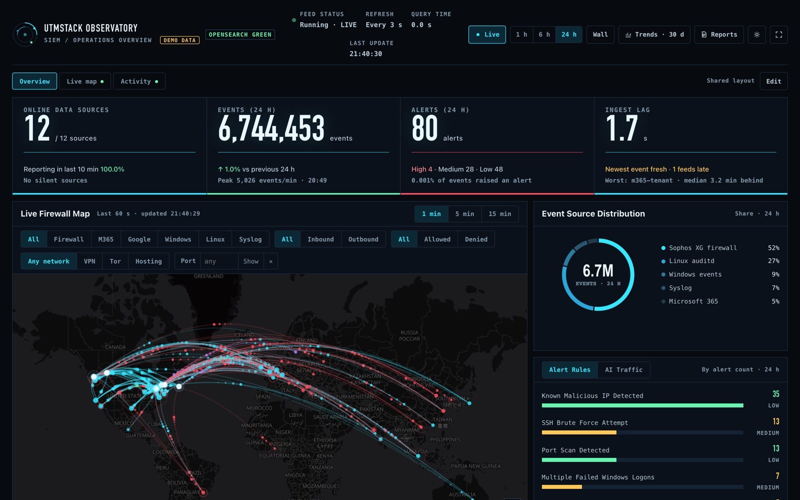

| You want to know… | Look at |
|---|---|
| Is every log source still sending? | **Online data sources** card |
| How busy is the SIEM, and is that normal? | **Events** card (with change against the previous period) |
| Is anything being flagged? | **Alerts** card and the **Alert Rules** panel |
| Are logs arriving late? | **Ingest lag** card |
| Where is traffic going, and who is attacking us? | **Live map** |
| Is UTMStack's database healthy? | The **OpenSearch** status badge next to the title |
| How does this week compare with last week? | **Trends** |
| Something to send to management | **Reports** (PDF or HTML) |

The dashboard refreshes itself every few seconds. **Live** in the header means you are looking at current data.

## 2. Signing in

Open the address your administrator gave you, for example `http://siem-server:8765` (or `https://…` if TLS is on).
Your browser asks for a user name and password. The default user is `admin`; the installer generates the password
and prints it once at the end of the install.

- After **5 wrong passwords** from the same address, that address is locked out for **15 minutes**, even if the next
  attempt is correct. Both numbers can be changed (see [Configuration reference](#15-configuration-reference)).
- To change the password, use the [Settings panel](#12-settings-panel) or `sudo ./install.sh password` on the server.
- To sign out, close the browser. Basic authentication has no sign-out button.

## 3. The header

| Control | What it does |
|---|---|
| **Logo** | Shows your support contact (name, email, phone, website) and the installed version. |
| **OpenSearch status badge** (green / yellow / red) | Health of UTMStack's database. Click it to see what is causing a yellow or red state and how to fix it. See [SIEM health](#8-siem-health). |
| **Feed status / Last update** | Whether the dashboard is receiving data and when it last refreshed. |
| **Live · 1 h · 6 h · 24 h** | Time range for the counters, the event-source donut, the top alert rules and the alert list. **Live** keeps the default 24-hour view moving. |
| **Wall** | Full-screen NOC mode with site names hidden. See [Wall mode](#wall-mode). |
| **Trends · 30 d** | 30 days of history with daily and weekly comparisons. |
| **Reports** | Generated PDF/HTML reports and a **Generate now** button. |
| **Gear** | Settings panel. |
| **Full screen** | Uses the whole monitor without entering Wall mode. |

Below the header are the **screen tabs** (Overview, Live map, Activity, and any screens you add) and the **Edit**
button for changing the layout.

## 4. Overview screen

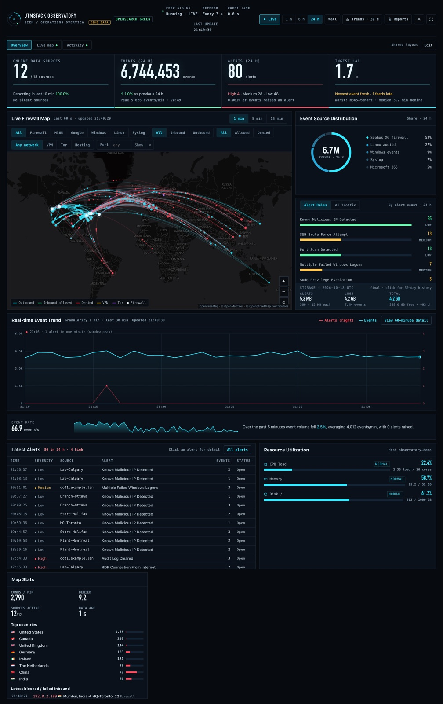

**KPI cards** (top row):

- **Online data sources**: sources that reported in the last 10 minutes, out of all known sources. *No silent
  sources* means everything is reporting. Click the card for the full source list.
- **Events**: events stored in the selected period, the change against the previous period, and the peak rate.
- **Alerts**: alerts raised in the period, split by severity (High / Medium / Low), and the share of events that
  raised an alert. Click it for the alert list.
- **Ingest lag**: how old the newest stored event is. A green value of a few seconds is normal. Click it for the
  per-source analysis.

**Panels** (all movable, see [Screens and widgets](#11-screens-widgets-and-wall-mode)):

- **Live firewall map**: a compact version of the [Live map](#5-live-map).
- **Event source distribution**: a donut of events by source type (firewall, Linux, Windows, syslog, Microsoft 365…).
- **Alert Rules**: the rules raising the most alerts. **Click a rule** to open its alerts.
- **AI Traffic** (optional): bytes in and out of chosen servers, for example AI or GPU hosts, measured from firewall
  logs. Turned on by listing hosts in the Settings panel.
- **Alert timeline**, **storage**, **resources** and other widgets can be added from the widget catalogue.

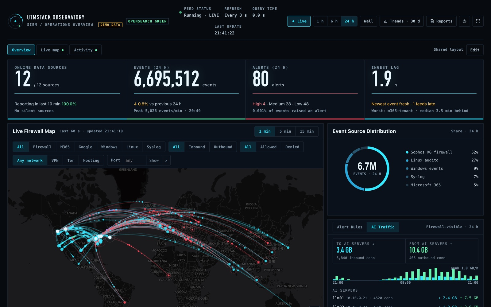

## 5. Live map

The Live map draws every connection the firewalls log as an arc between the firewall and the remote city, and plots
attackers seen in server and cloud logs.

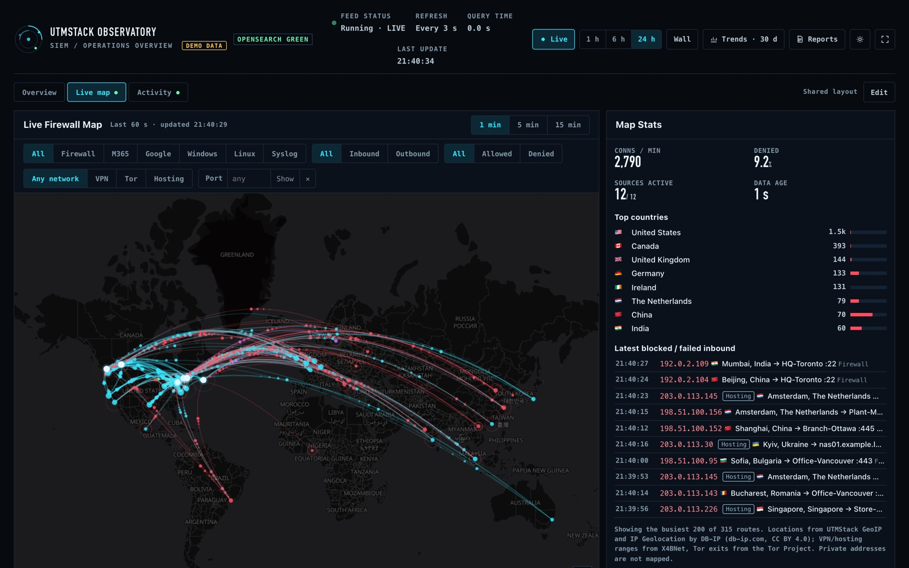

### Reading the map

| Colour | Meaning |
|---|---|
| Cyan | Outbound: a local device connected out |
| Blue-green | Inbound and allowed |
| Red | Denied or failed (blocked by the firewall, or a failed login) |
| Yellow | From a known VPN range |
| Purple | From a Tor exit node |
| White dots | Your firewalls |

Arcs move in the direction of the traffic. The side panel shows connections per minute, the percentage denied, top
countries, and **Latest blocked / failed inbound**, a ticker of the newest blocked connections with their source
address, location, target and port. Badges on a row mark **VPN**, **Tor** or **Hosting** (datacenter) addresses.
Hover a ticker row to highlight that location on the map.

### Window and filters

- **1 min · 5 min · 15 min**: how much recent traffic is drawn.
- **Source**: All, Firewall, M365, Google, Windows, Linux, Syslog. Only sources that carry IP addresses can be
  placed; a short bar at the top of the map says so when the selected source has nothing to show.
- **Direction**: All, Inbound, Outbound.
- **Outcome**: All, Allowed, Denied.
- **Network**: Any network, VPN, Tor, Hosting.
- **Port**: type a port (for example `22`, `3389`, `443`) and press **Enter** or **Show** to see only traffic to that
  port. **✕** clears it. Windows and Microsoft 365 events carry no port, so they drop out while a port is set.

All filters combine. The side panel and ticker follow them.

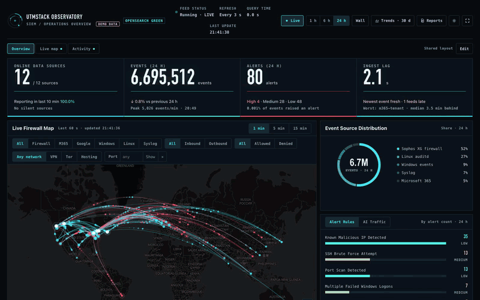

*Tor traffic only:*

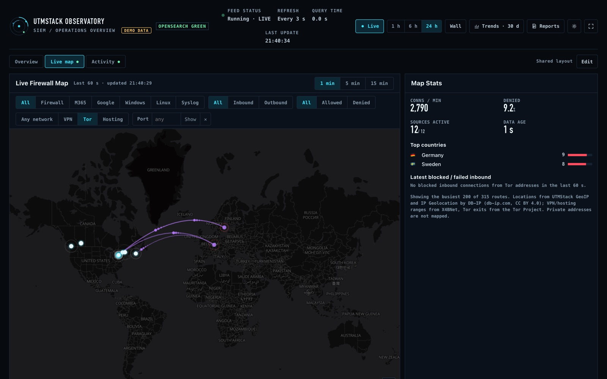

*Port search: where SSH (22) and RDP (3389) attempts come from:*

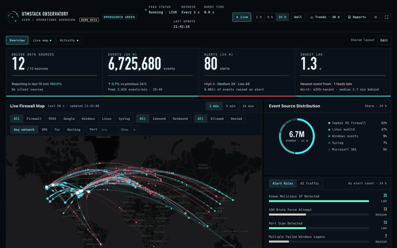

*Attackers found in server logs (syslog / SSH):*

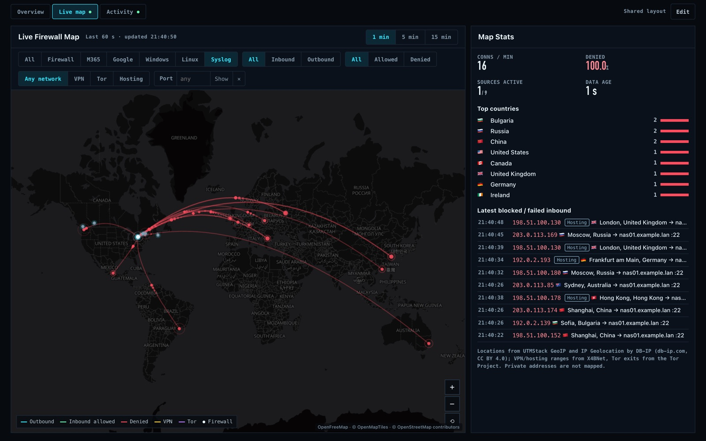

### Zoom and street map

Use **+ / − / ⟲**, the mouse wheel, double-click or drag; on a phone, pinch and drag (a single tap shows a tooltip).
Zoom in far enough and a street-level map appears underneath the arcs.

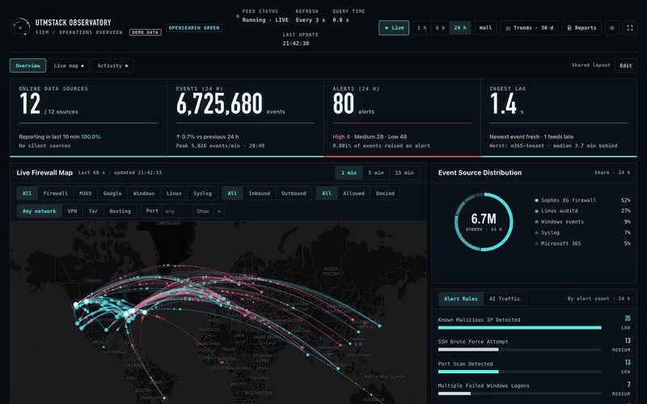

> IP-based location is city-level at best. The street map adds context; it does not pinpoint an attacker's building.

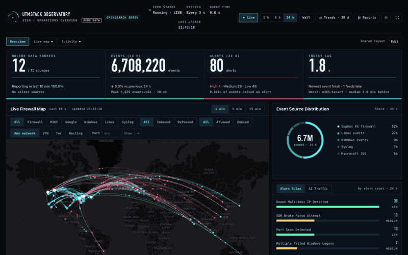

### Where locations come from

1. UTMStack's own GeoIP enrichment, when present in the log.
2. A local copy of the DB-IP City Lite database, plus VPN, datacenter and Tor exit lists, downloaded and refreshed
   automatically by the dashboard.
3. Optionally, an online lookup (proxycheck.io) for addresses the local data cannot place, capped at a daily
   number (default 100, `0` turns it off).

Private addresses (10.x, 192.168.x, …) are never placed on the map and never sent anywhere.

## 6. Alerts

Click a rule in **Alert Rules**, or the **Alerts** card, to open the alert list.

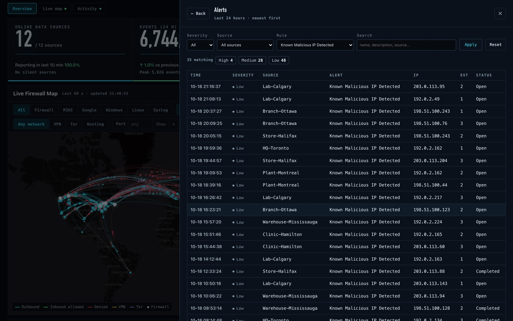

Filter by **Severity**, **Source**, **Rule** and free-text **Search**, then **Apply**. **Newer / Older** page
through the results.

Click an alert to open its detail:

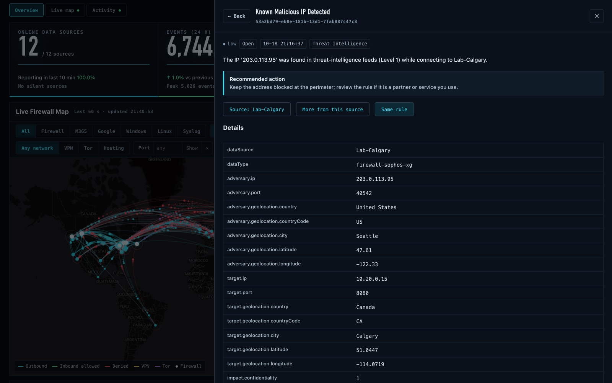

- **Recommended action**: what to do about it, in plain language.
- **Source**, **More from this source**, **Same rule**: jump to related alerts.
- **Details**: every field UTMStack stored for the alert.
- **Reputation**: live AbuseIPDB score and VirusTotal detections for the alert's public addresses, when API keys are
  configured.
- **WHOIS**: who owns each public address (registry, organisation, abuse contact).

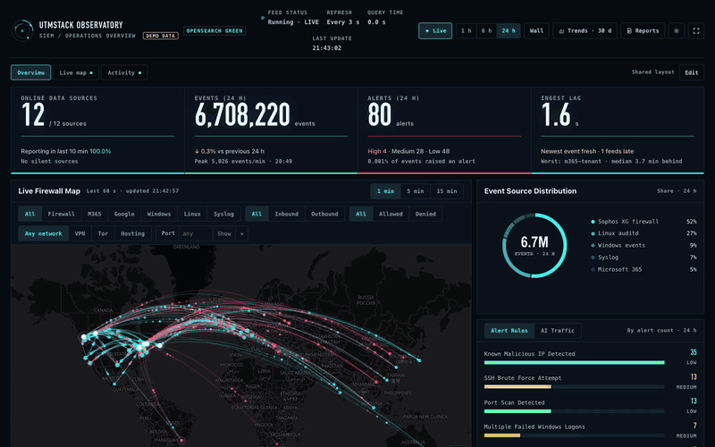

## 7. Data sources and ingest lag

Click **Online data sources** for every source, its type, event count, share, a 24-hour sparkline, when it last
reported and its status. Switch between **By source** and **By type**.

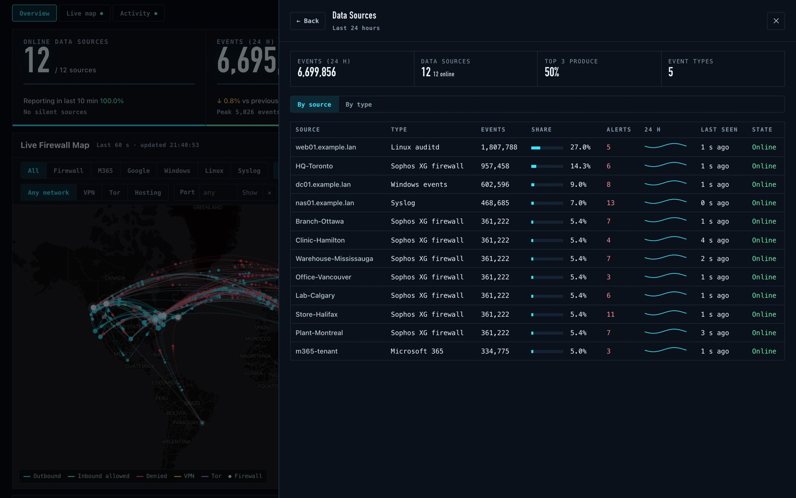

Click a source for its event history, the alerts it raised and its most recent events:

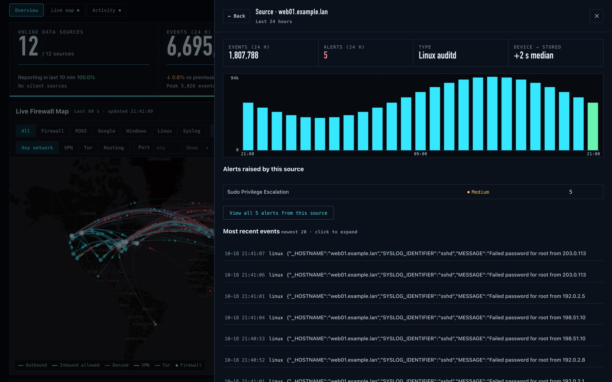

Click **Ingest lag** for the delay per source: the time between when a device logged an event and when UTMStack
stored it. Firewalls often send logs in batches, and Microsoft 365 is polled, so a delay of minutes is normal for
those.

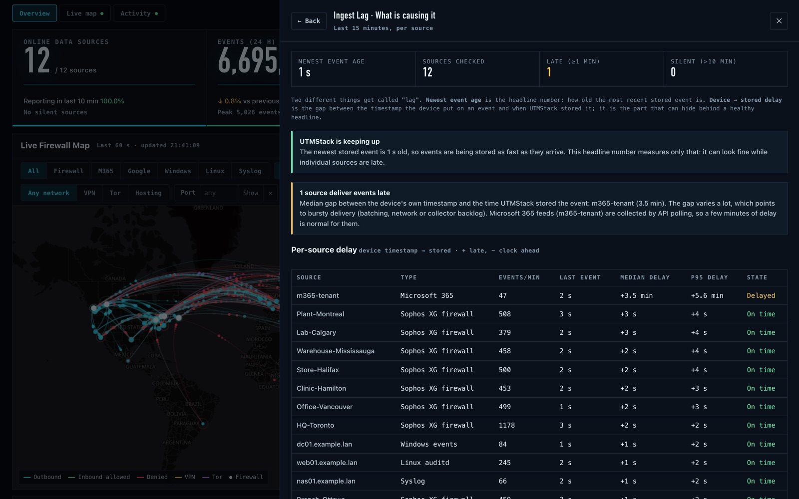

## 8. SIEM health

The badge next to the title shows the health of UTMStack's OpenSearch cluster. Click it for an explanation in plain
language: whether data is safe, which shards are unassigned and why, and the commands that fix it.
**Copy diagnostics** puts the technical details on the clipboard for your support provider.

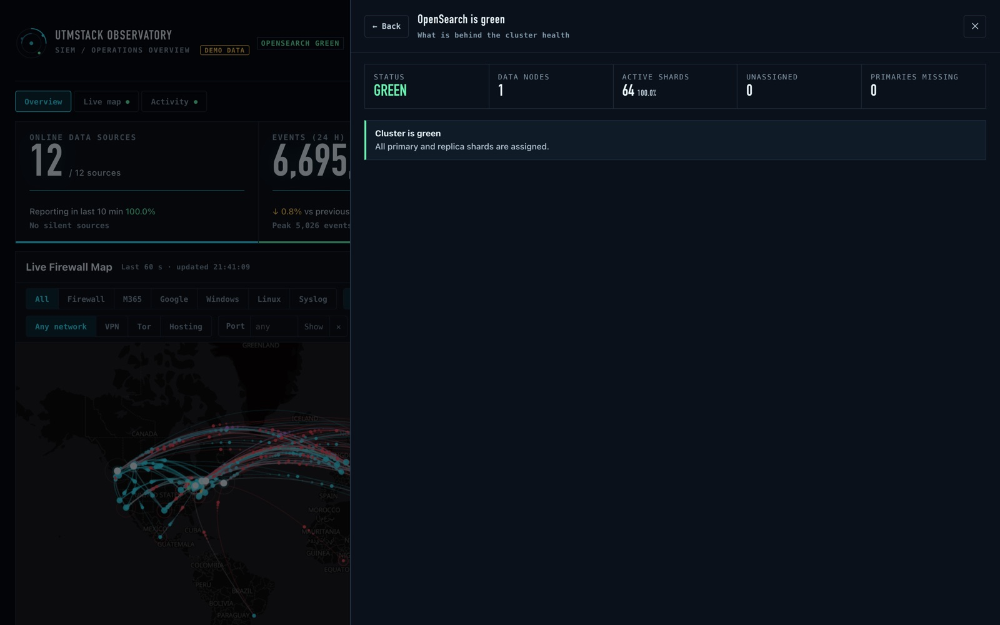

| Badge | Meaning |
|---|---|
| Green | Everything is assigned and searchable. |
| Yellow | All data is available, but some replica copies are missing. Common on single-node installs; usually not urgent. |
| Red | Some data is not searchable. Act on the advice in the panel. |

## 9. Trends and history

**Trends · 30 d** shows hourly history for the last 30 days (events, alerts and, if enabled, AI traffic), a
**daily comparison** (last 24 h against the 24 h before) and a **weekly comparison** (last 7 days against the
7 before).

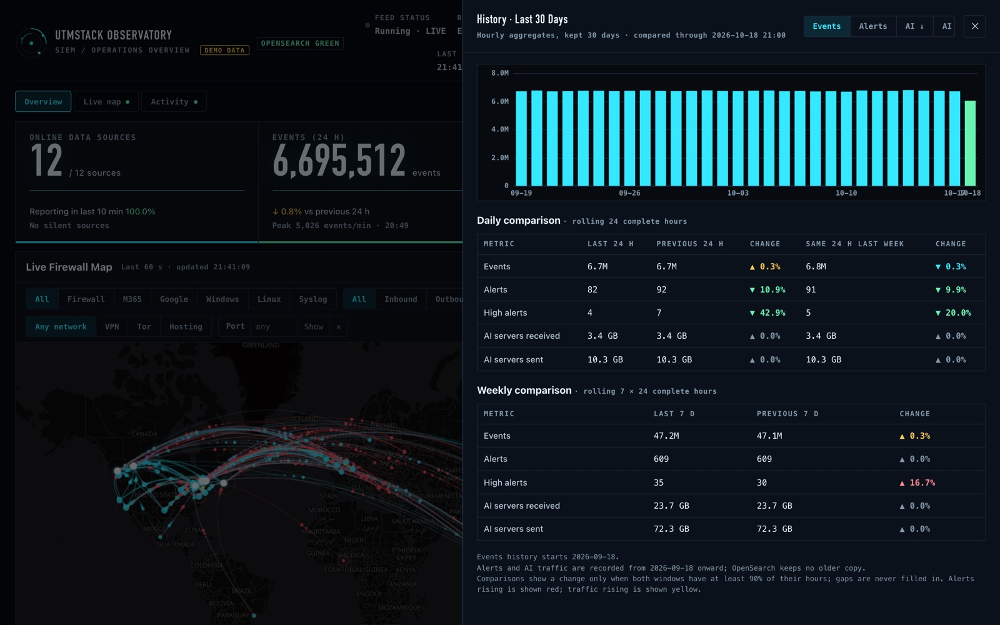

OpenSearch on a UTMStack server usually keeps raw logs for only about a day, so the dashboard keeps its own small
history database (counts only, never raw events). History starts when the dashboard is installed. Comparisons show
*n/a* or *partial* until both periods have at least 90% of their hours: about a day for daily, two weeks for weekly.

## 10. Reports

**Reports** lists generated reports, newest first, each as **PDF** and **HTML**. **Generate now** makes one for the
last 24 hours: key figures and trends, top alert rules and recent alerts (with the MITRE ATT&CK technique where the
rule has one), top blocked countries from the map, and storage health.

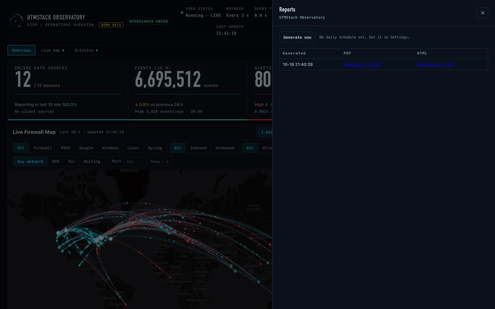

To get a report every day automatically, set **Report hour** (0–23, UTC) in the Settings panel. The last 30 reports
are kept. Downloads need the dashboard login.

A sample report made from demo data is in [`../media/sample-report.pdf`](../media/sample-report.pdf).

## 11. Screens, widgets and Wall mode

### Editing the layout

Click **Edit** (right of the screen tabs).

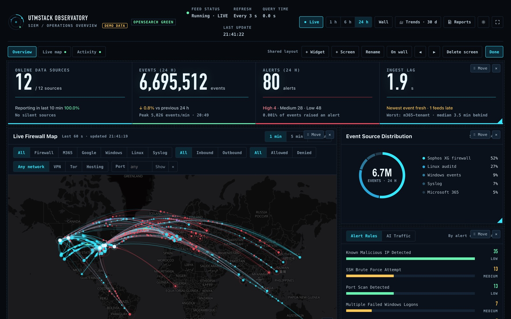

- Drag a panel by its **⠿ Move** handle; resize it from the corner.
- **+ Widget** opens the widget catalogue. **+ Screen** adds a new tab; **Rename** and **Delete screen** manage it.
- **On wall** includes the screen in Wall-mode rotation.
- **Save as shared default** makes your layout the one everyone sees. **Reset to shared** drops your personal changes.
- Click **Done** to leave edit mode.

Without saving as shared, layout changes are personal to your browser.

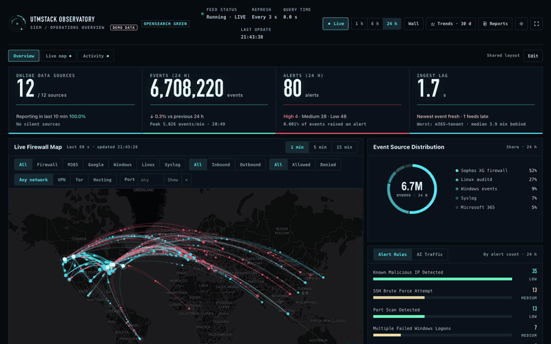

### Wall mode

**Wall** (or open `/?wall=1`) turns the dashboard into a NOC display: full screen, rotating through the screens
marked *On wall* every 30 seconds. Firewall names and WAN addresses are replaced by **Site A, Site B…** on the server
before they are sent, so a wall screen in a lobby never shows them. Panels that list data-source names are left out.
Press **Esc** to leave.

### Phones and tablets

The dashboard works on a phone. Panels stack, and the map gets a taller view with touch zoom.

<p>
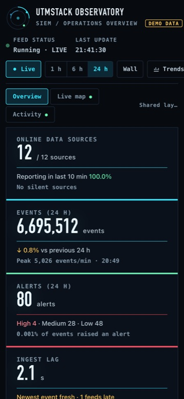
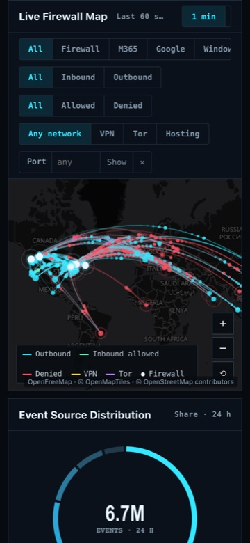
</p>

## 12. Settings panel

The **gear** icon opens Settings. Changes apply immediately, with no restart. Changing the login, an API key or the
support contact needs your **current password** in the *Confirm* field at the bottom. A value saved here overrides the
matching installer option; clearing a field and saving falls back to the installer's value.

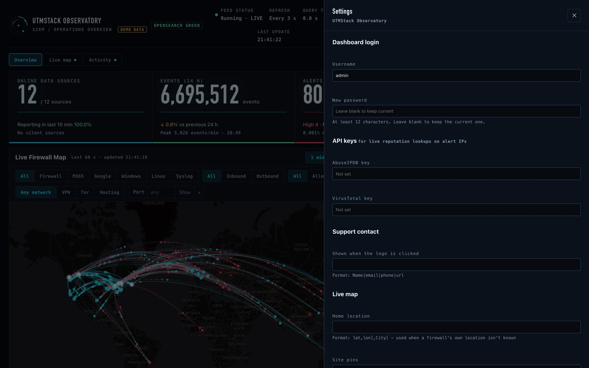

| Section | Settings |
|---|---|
| **Dashboard login** | User name and password (at least 12 characters). Changing the password signs you out so you sign in again with the new one. |
| **API keys** | AbuseIPDB and VirusTotal keys for the Reputation section of alert detail. Keys are write-only: the panel shows whether a key is set, never the key itself. |
| **Support contact** | Name, email, phone and website shown when the logo is clicked. |
| **Live map** | Home location (where firewalls without a known location are drawn) and site pins (`FirewallName=lat,lon,City;203.0.113.7=lat,lon`). |
| **AI traffic** | Hosts to measure, as `name=ip,name=ip`. Empty hides the AI Traffic tab. |
| **Reports** | Daily report hour (0–23, UTC). Empty means on demand only. |
| **Dashboard layout** | Shortcut to the layout editor. |

## 13. Demo mode

Demo mode runs the dashboard on realistic, fully synthetic data, for sales demos, training and screenshots. It needs
no UTMStack and no internet connection (the street map tiles excepted).

- A fictional organisation: eight Canadian sites, Linux, Windows and storage servers, and a Microsoft 365 tenant.
- Every panel, drill-down, report, WHOIS and reputation lookup answers with sample data that moves over time like a
  live system.
- All public addresses come from the reserved documentation ranges `192.0.2.0/24`, `198.51.100.0/24` and
  `203.0.113.0/24`, so no screenshot can show a real company's address.
- A yellow **DEMO DATA** tag appears next to the title.

Start it on any machine with Python 3.10+ and `pip install -r requirements.txt`:

```bash
cd app
DEMO=1 DASH_PASS=choose-a-password python3 server.py
```

Then open `http://<machine>:8765`. Demo mode is off unless `DEMO=1` is set; never set it on a production install.

## 14. Installation and upgrades

**Requirements:** a UTMStack v11 server (Docker Swarm), root or sudo, and internet access for the first image build.

```bash
git clone https://github.com/vbeitner/utmstack-observatory.git
cd utmstack-observatory
sudo ./install.sh
```

The installer finds the UTMStack stack, reads the OpenSearch credentials UTMStack already uses, checks they work,
builds the image, starts the service and prints the address and a generated password.

To **upgrade**, get the new version and run the installer again (`git pull && sudo ./install.sh`). Password,
settings and history are kept.

| Command | What it does |
|---|---|
| `sudo ./install.sh` | Install or upgrade |
| `sudo ./install.sh status` | Service state and health |
| `sudo ./install.sh logs` | Service logs |
| `sudo ./install.sh password [NEW]` | Set a password, or generate a new one. Also removes a password set in the Settings panel, so it revokes it |
| `sudo ./install.sh uninstall` | Remove the service, keep history and settings |
| `sudo ./install.sh uninstall --purge` | Remove everything, including history, settings and the image |

## 15. Configuration reference

### Installer options

Options are remembered in `/etc/utmstack-observatory/config.env`; pass one again to change it.

| Option | Default | Meaning |
|---|---|---|
| `--port N` | `8765` | Port the dashboard listens on |
| `--user NAME` | `admin` | Dashboard user name |
| `--password PW` / `--password-file F` | generated | Dashboard password (12+ characters; the file form keeps it out of the process list) |
| `--tls` / `--no-tls` | on for new installs | HTTPS with a generated self-signed certificate, or plain HTTP |
| `--tls-cert FILE --tls-key FILE` | | HTTPS with your own certificate |
| `--tz ZONE` | host's | Time zone for day boundaries, e.g. `America/Toronto` |
| `--stack NAME` | auto | UTMStack Swarm stack name |
| `--import-history FILE` | | Seed history from an earlier install |
| `--sites "Name=lat,lon,City;IP=lat,lon"` | | Pin firewalls the map cannot place |
| `--home "lat,lon,City"` | Toronto | Where unplaced firewalls are drawn |
| `--support "Name\|email\|phone\|url"` | vendor | Contact shown under the logo |
| `--ai-hosts "name=ip,name=ip"` | off | Enable AI Traffic for these hosts |
| `--abuseipdb-key KEY` | off | AbuseIPDB reputation lookups |
| `--virustotal-key KEY` | off | VirusTotal reputation lookups |
| `--proxycheck-key KEY` | none | proxycheck.io key for the online location fallback |
| `--geoip-online-daily N` | `100` | Daily cap on online lookups; `0` disables them |

### Environment variables

Only needed when running `app/server.py` yourself; the installer sets them for you.

| Variable | Default | Meaning |
|---|---|---|
| `OS_URL` | | OpenSearch URL, e.g. `https://node1:9200`. Empty = use `docker exec` on the host |
| `OS_USER`, `OS_PASS` / `OS_PASS_FILE` | | OpenSearch credentials |
| `DASH_USER`, `DASH_PASS` / `DASH_PASS_FILE` | `admin` | Dashboard login. Without a password it only listens on 127.0.0.1 |
| `PORT`, `BIND` | `8765`, `0.0.0.0` | Listening port and address |
| `TLS_CERT`, `TLS_KEY` | | Certificate and key files; enables HTTPS |
| `DATA_DIR` | app folder | History database, settings, layout, reports and IP data |
| `DISK_PATH` | `/utmstack` | Filesystem whose free space is reported |
| `HOST_NAME`, `TZ` | | Host name shown in the resource panel; time zone |
| `STACK_NAME` | `utmstack` | UTMStack stack name |
| `AI_HOSTS` | | `name=ip,name=ip` |
| `SITE_LOCATIONS`, `HOME_LOCATION` | | Same as `--sites` and `--home` |
| `SUPPORT_CONTACT` | | Same as `--support` |
| `ABUSEIPDB_KEY`, `VIRUSTOTAL_KEY` (or `_FILE`) | | Reputation API keys |
| `PROXYCHECK_KEY`, `GEOIP_ONLINE_DAILY` | , `100` | Online location fallback |
| `LOGIN_MAX_FAILURES`, `LOGIN_LOCK_S` | `5`, `900` | Lockout after N failures, for S seconds |
| `MAX_CONNECTIONS`, `MAX_CONNECTIONS_PER_IP` | `64`, `32` | Concurrent connections in total and per address; extra ones are refused at once |
| `HEADER_DEADLINE_S` | `10` | A client must send its whole request header within this time |
| `ALLOWED_HOSTS` | | Extra host names accepted when no login is configured (otherwise only localhost) |
| `OS_CA_FILE`, `OS_CHECK_HOSTNAME` | , `1` | Verify OpenSearch's certificate against this CA |
| `REQUEST_TIMEOUT_S` | `15` | Slow or idle clients are dropped after this |
| `DEMO` | off | `1` = demo mode, see [Demo mode](#13-demo-mode) |
| `ALLOW_NO_AUTH` | off | `1` = allow listening on a network address with no password (testing only) |

### What is stored where

| What | Where |
|---|---|
| 30-day history, storage sizes | Docker volume `utmstack-observatory-data` → `/data/history.db` |
| Live settings, shared layout | `/data/settings.json`, `/data/layout.json` |
| Reports (last 30) | `/data/reports/` |
| IP location and VPN/Tor data | `/data/geoip/` |
| Installer settings | `/etc/utmstack-observatory/config.env` |
| Dashboard password | `/etc/utmstack-observatory/admin.pass` (root only); a password set in Settings is stored hashed |

## 16. Security and privacy

- **Read-only**: the dashboard only reads OpenSearch. It cannot change UTMStack.
- **Login on everything** except a minimal health check. Repeated wrong passwords lock out the source address.
  Changing the login, an API key or the support contact also asks for the current password, and every change is
  logged.
- **Container hardening**: read-only file system, all Linux capabilities dropped, unprivileged user, no Docker socket,
  password passed as a Docker secret.
- **Browser protections**: a Content Security Policy that allows only the dashboard's own scripts, protection
  against cross-site request forgery on every change, and no third-party scripts (the map library is bundled).
- **Encryption**: new installs use HTTPS with a self-signed certificate (browsers warn once; `--tls-cert`/`--tls-key`
  for your own). Installs from before 1.16 keep plain HTTP until re-run with `--tls`.
  Docker Swarm publishes the port on every interface, so restrict it with the host firewall, for example:
  `iptables -I DOCKER-USER -p tcp --dport 8765 ! -s 100.64.0.0/10 -j DROP`.
- **What leaves the server**: public IP addresses for WHOIS (rdap.org), reputation (AbuseIPDB, VirusTotal, only if
  keys are set) and the optional location fallback (proxycheck.io); periodic downloads of IP location and VPN/Tor
  lists; map tiles fetched by the browser from OpenFreeMap. Private addresses are never sent.
- **Stored data**: counts and aggregates only, never raw log events.

The security assessment is in [`../security/SECURITY-ASSESSMENT.md`](../security/SECURITY-ASSESSMENT.md).

## 17. Troubleshooting

| Symptom | What to check |
|---|---|
| "No traffic on the map" | Usually ingestion, not the dashboard: is the firewall still sending logs to UTMStack? Check **Data sources**. |
| Installer: OpenSearch rejects the credentials (HTTP 401) | UTMStack itself is broken (its backend uses the same credentials). Fix UTMStack first, then re-run the installer. |
| Trends shows *n/a* or *partial* | Not enough history yet: about a day for daily, two weeks for weekly comparisons. |
| Ingest lag ~1 s but feeds are late | The headline is the newest event; click the card for the per-source delay. |
| AI Traffic empty or low | It only sees traffic that crosses the firewall, not traffic inside the LAN. |
| Street map does not appear | The browser cannot reach `tiles.openfreemap.org`; the outline map is used instead. |
| Locked out | Wait 15 minutes, or restart the service, which clears the lockout. |
| Anything else | `sudo ./install.sh logs` and `sudo ./install.sh status`; **Copy diagnostics** in the health panel. |

## 18. Third-party data and licences

| Component | Use | Licence |
|---|---|---|
| MapLibre GL JS 4.7.1 | Street map rendering (bundled) | BSD-3-Clause |
| OpenFreeMap / OpenStreetMap | Map tiles | ODbL (© OpenStreetMap contributors) |
| DB-IP City Lite | IP location | CC BY 4.0, "IP Geolocation by DB-IP" |
| X4BNet lists_vpn | VPN and datacenter ranges | See the project's repository |
| Tor Project exit list | Tor exit nodes | Public data |
| Natural Earth (via world-atlas) | Outline map | Public domain |
| fpdf2 | PDF reports | LGPL-3.0 |

Attribution for the map and IP data is shown in the dashboard itself, under the map.
